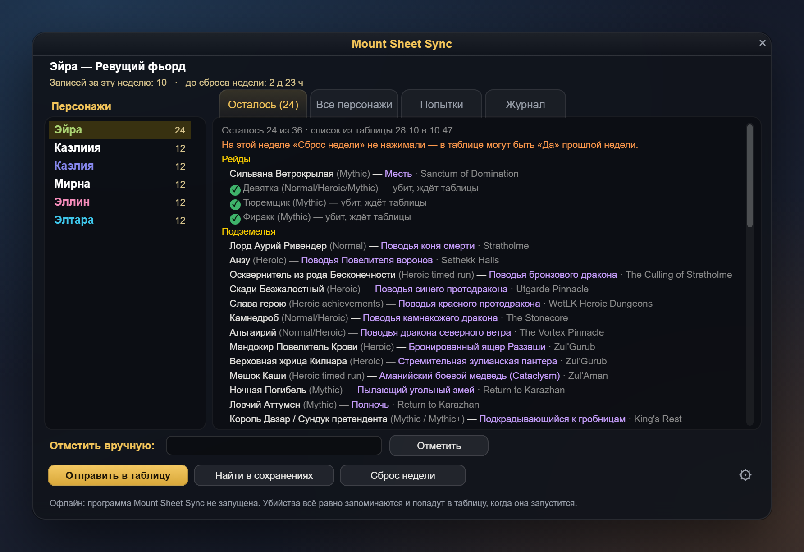
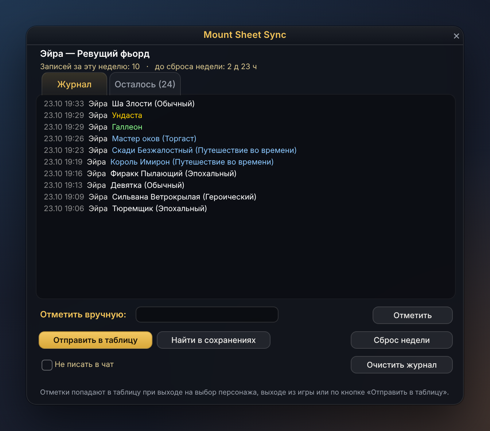
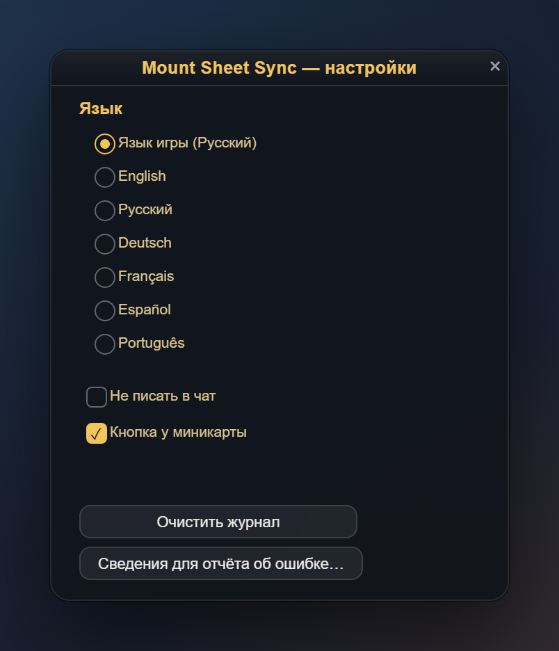
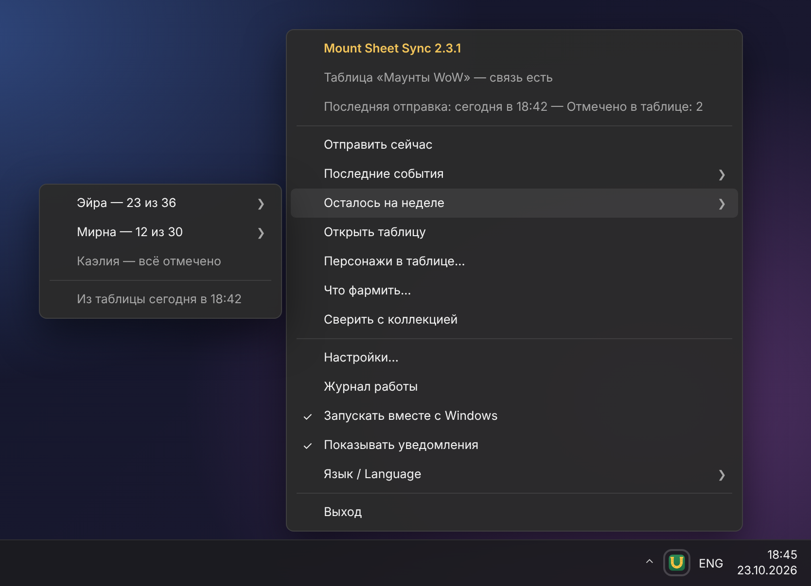
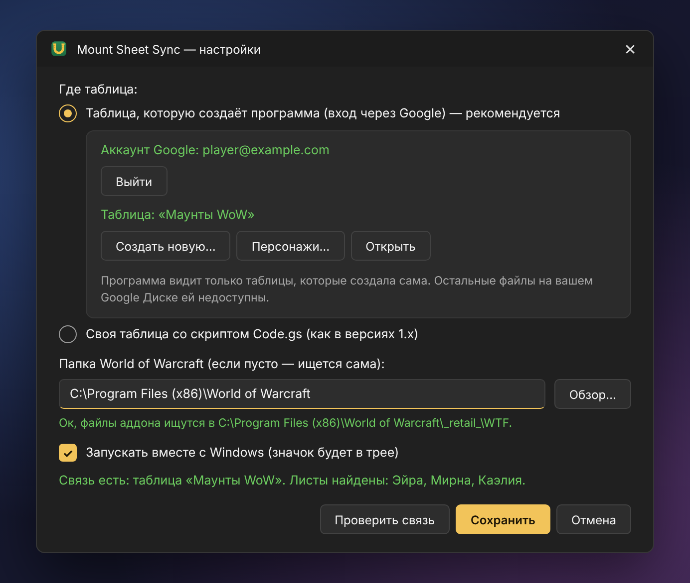
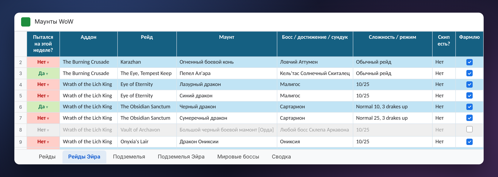

# Mount Sheet Sync

[English](README.md) · [Сайт](https://zlodyaga.github.io/) · [Политика конфиденциальности](https://zlodyaga.github.io/privacy.html#ru)

Аддон для World of Warcraft и небольшая программа в трее Windows, которые сами ведут Google-таблицу фарма маунтов:
каких боссов каждый персонаж убил на этой неделе, какие маунты уже собраны и что ещё осталось.

- **Аддон** (WoW Retail, Midnight 12.x) запоминает убийства боссов, персонажей и коллекцию маунтов и показывает в игре
  список «Осталось» для текущего персонажа.
- **Программа** (Windows 10/11, ничего устанавливать не нужно) следит за файлом аддона, создаёт таблицу на вашем
  Google Диске и отмечает в ней убийства и собранные маунты. Список «Осталось» она приносит обратно в игру.

Аддон и программа говорят по-русски, по-английски, по-немецки, по-французски, по-испански и по-португальски
(аддон — на языке игры, программа — на языке Windows; оба можно переключить). Таблицу тоже можно сделать на любом из
этих языков — язык выбирается при создании (по умолчанию язык игры). Названия маунтов, боссов и подземелий тогда
берутся из игры, если она на этом языке; советы по фарму в немецкой, французской, испанской и португальской таблице —
по-английски.

## Как это выглядит

| «Осталось» на неделе | Журнал | Настройки |
| --- | --- | --- |
|  |  |  |

Окно аддона (русский клиент, примерные персонажи). Нарисовано по настоящей разметке аддона — те же окна, размеры и
тексты, что он создаёт в игре, — скриптом `tools/screens/render.py`; в игре окно выглядит в стиле вашего интерфейса.

| Программа в трее | Её настройки |
| --- | --- |
|  |  |

Таблица — начало листа рейдов персонажа:

Тексты и меню программы — её собственные, нарисованы в стиле Windows 11; лист — такой, каким его создаёт программа,
с несколькими примерными отметками (`tools/screens/program.py`).

## Установка

1. **Аддон:** установите *Mount Sheet Sync* через CurseForge или скопируйте папку `MountSheetSync` из архива выпуска в
   `World of Warcraft\_retail_\Interface\AddOns`.
2. **Программа:** скачайте `MountSheetSync-<версия>.zip` в [Releases](../../releases), распакуйте в обычную папку
   (например, «Документы») и запустите `2-program\MountSheetSync.exe`. Если Windows напишет «Windows защитила ваш
   компьютер» — «Подробнее» → «Выполнить в любом случае» (программа без цифровой подписи, весь её код — здесь).
3. В окне настроек: **Войти через Google…** → **Создать таблицу…** → выберите язык таблицы и отметьте персонажей.
   Готово: зайдите в игру, убейте босса, выйдите на выбор персонажа — в таблице появится «Да».

Подробная инструкция — [docs/README.ru.txt](docs/README.ru.txt) (в архиве выпуска это `README.txt`).

## Конфиденциальность

- Программа просит у Google только доступ `drive.file` (и адрес почты — показать, какой аккаунт подключён). С ним она
  видит **только таблицы, которые создала сама** — остальной Google Диск ей недоступен.
- Всё работает на вашем компьютере, никаких наших серверов посередине нет: программа обращается к Google напрямую.
- Ключ входа хранится в `%APPDATA%\MountSheetSync\google-token.dat`, зашифрованный Windows (DPAPI) для вашей учётной
  записи. «Выйти» в настройках отзывает его.
- Аддон ничего никуда не отправляет — у аддонов WoW нет доступа к сети. Он только пишет свой файл SavedVariables.

## Сборка, тесты, переводы

См. [README.md](README.md#building): `program\build.cmd` (компилятор C#, встроенный в Windows), `tools/package.sh`,
`tools/run_tests.sh`, переводы программы — `tools/i18n`.

## Лицензия

[MIT](LICENSE). Библиотеки в `Libs`: LibStub и LibDataBroker-1.1 (общественное достояние), CallbackHandler-1.0
(лицензия Ace3, `Libs/CallbackHandler-1.0/LICENSE.txt`).
