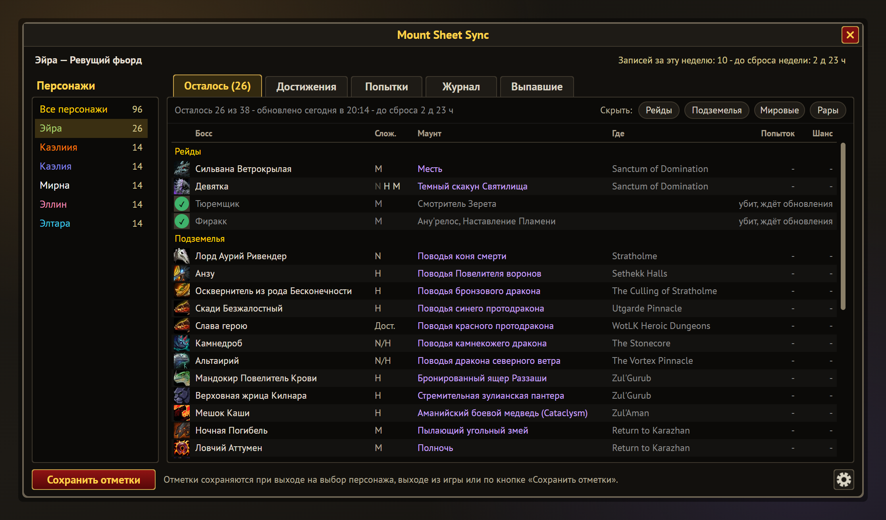
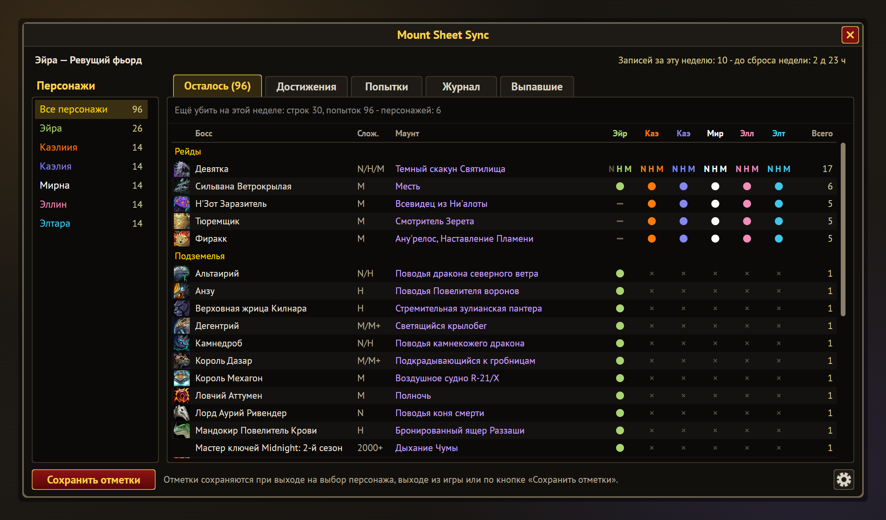
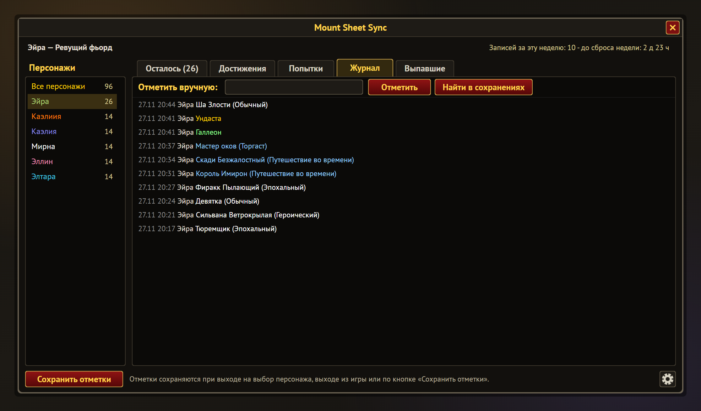
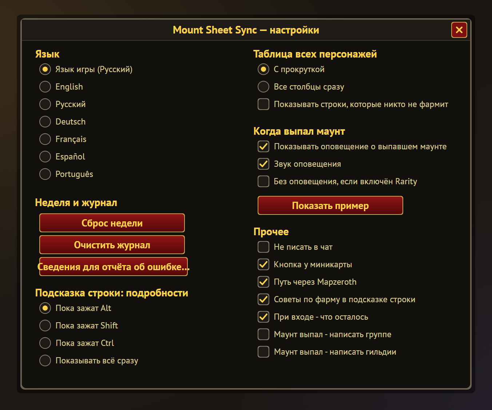

# Аддон (WoW Retail, Midnight 12.x)

Папка репозитория — это и есть аддон (`MountSheetSync.toc` в корне). Версия — `## Version:` в toc и `VERSION` в
`MountSheetSync.lua`; выпуск проверяет, что тег совпадает с toc (см. [release.md](release.md)).

## Файлы (порядок из toc)

| Файл | Что делает |
| --- | --- |
| `Libs/` | LibStub, CallbackHandler-1.0, LibDataBroker-1.1 (кнопка Data Broker) |
| `SheetData.lua` | `MountSheetSyncSheet` — список «Осталось» из таблицы; **пишет программа**, в выпуске пустой (`= nil`) |
| `Program.lua` | `MountSheetSyncProgram = { seen, sheet, version }` — «программа запущена»; **пишет программа** раз в минуту, в выпуске `= nil` |
| `Locale.enUS.lua` … `Locale.ptBR.lua` | Тексты, по файлу на язык: `T.<код>` и слова для игрока без Google-таблицы `ns.LIST_WORDS.<код>`; новый ключ — во все шесть файлов (следит `test_locale.py`) |
| `Locales.lua` | `ns.L`, выбор и смена языка (`ns.SetLanguage`, `ns.ApplyLanguage`); грузится после файлов языков |
| `MountSheetSync.lua` | Ядро: события, запись убийств, сохранения подземелий, ручные отметки, `/mss`, `ns.ProgramState()` |
| `Statistics.lua` | `ns.STATISTIC_IDS` — статистики убийств, которые читает аддон (**генерирует** `tools/catalog/statistic_ids.py`, не править руками) |
| `Entrances.lua` | `ns.ENTRANCES` — запасная точка входа каждого рейда и подземелья каталога: `[journalInstanceID] = { map, x, y }`; `ns.RARE_SPOTS` — точка рара по mountID из колонки каталога «Точка» (`{ map, x, y }`, у раров с несколькими местами — `{ map }`) (**генерирует** `tools/catalog/entrances.py`, не править руками) |
| `Access.lua` | `ns.ACCESS` — входы, закрытые сюжетом или фазой: задания (`quests`), достижения этого персонажа (`ach`), общий ли доступ на аккаунт (`account`), хватает ли взятого задания (`inlog`), шаги цепочки (`steps`: задание, фракция, место выдачи), подсказка (`hint` → `L.access_<hint>`) и пометка после доступа (`after`); `ns.AccessCheck(instance)`, `ns.RememberAccess()` (при входе в игру) |
| `Collection.lua` | Персонажи (`db.chars`), их статистика убийств (`ns.ScanStatistics`), коллекция маунтов (`db.collection`), снимок Атласа приключений для программы |
| `Remaining.lua` | Список «Осталось» и сравнение имён/сложностей (порт `norm_`/`rowMatch_` из Code.gs), все персонажи (`ns.GetAllRemaining`, `ns.GetSummary`), счётчик попыток (`ns.AttemptsFor`, `ns.BossHint`, `ns.GetAttemptsList`) |
| `Skin.lua` | Своё оформление окон (не шаблоны Blizzard): шрифты `MSSFont…`, окно, панель, кнопка, «таблетка», вкладка, галочка и переключатель, поле ввода; белые текстуры `Media/*.tga` красятся `SetVertexColor`, делает их `tools/skin/make_media.py` |
| `UI.lua` | Основа окна: размеры и константы, помощники (кнопки, подсказки, подтверждения), короткие названия, открытие достижения, маунта и Атласа; здесь же заводятся общие таблицы `UI`, `S`, `P` (см. ниже) |
| `UI.Route.lua` | Путь к боссу: вход на карте, запасные точки, закрытые входы (`ShowAccessStep`), Mapzeroth (`Mz`), `ShowRoute` |
| `UI.Rows.lua` | Строки списков: ячейки, сетка «Все персонажи», щелчки, меню и подсказки строк, левая панель персонажей |
| `UI.Views.lua` | Столбцы таблиц и содержимое вкладок: «Осталось», сетка, «Достижения», «Попытки», «Журнал», «Выпавшие» |
| `UI.Window.lua` | Рамка окна, шапка таблицы, `UI.Refresh`, выбор вкладки и персонажа, `UI.Toggle` |
| `UI.Settings.lua` | Окно настроек (язык, галочки, вид сетки, кнопки) и «Сведения для отчёта об ошибке» |
| `UI.Minimap.lua` | Кнопка у миникарты, Data Broker, Addon Compartment |
| `Alert.lua` | Оповещение о выпавшем маунте (`ns.ShowDrop`, `/mss drop`) |
| `Tooltip.lua` | Подсказка о боссе: подсказка юнита (`TooltipDataProcessor`) и строка в Атласе приключений |
| `Media/Icon*` | Значок-подкова (тот же, что у программы) |

## Как файлы окна делят общее (3.0.7)

В Lua 5.1 в одном файле не больше 200 локальных переменных; в едином `UI.lua` их было 196, поэтому окно разнесено на семь
файлов (порядок — в `.toc`). Общее — через три таблицы: `UI` (`ns.UI`) — то, что зовут снаружи (`UI.Toggle`, `UI.Refresh`,
`UI.SelectTab`, `UI.DropsView`…); `S` (`UI.state`) — состояние, которое меняется по ходу (кадры `S.frame`, `S.listBox`…,
`S.selectedChar`, `S.shownList`): локальной копией в другом файле его не взять; `P` (`UI.private`) — функции, константы и
таблицы, определённые один раз и нужные нескольким файлам: файл отдаёт их в конце (`P.Имя = Имя`) и берёт в начале
(`local Имя = P.Имя`). Новая общая функция — добавить её в оба места; новое изменяемое общее — поле `S`.

## События и записи журнала

Регистрируются в `MountSheetSync.lua` после `ADDON_LOADED`: `PLAYER_LOGIN`, `ENCOUNTER_END`, `BOSS_KILL`,
`UPDATE_INSTANCE_INFO`, `NEW_MOUNT_ADDED`, `LOOT_READY`, `PLAYER_TARGET_CHANGED`, `UPDATE_MOUSEOVER_UNIT`, `NAME_PLATE_UNIT_ADDED` (рары). `Tooltip.lua` ждёт `ADDON_LOADED` для `Blizzard_EncounterJournal`.

`MountSheetSyncDB.kills` — журнал, не больше `MAX_RECORDS = 400` записей и не старше `MAX_AGE` = 21 день.
Каждая запись: `char`, `realm`, `charKey` (GUID), `time`, `kind`, `id`, для убийств ещё `boss`, `encounterID`,
`instance`, `difficultyID`, `difficulty`, `weekEnd`.

| id | kind | Откуда |
| --- | --- | --- |
| `K-<charKey>-<encounterID>-<time>` | raid / party / scenario / world | `ENCOUNTER_END` или `BOSS_KILL` (дубль за 120 с отбрасывается) |
| `L-…` | raid / party | «Найти в сохранениях»: сохранения подземелий этой недели (продлённые пропускаются) |
| `W-<charKey>-<босс>-<lockEnd>` | world | сохранения мировых боссов |
| `D-<charKey>-<npcID>-<time>` | world | **рар** (не бой, без сохранений — напр. Исхак Повелитель Четырех Ветров): открыта добыча с трупа, чьё имя (у цели / под курсором с тем же GUID или запомненное: рары, которых игрок видел как цель, под курсором или по табличке, `rareNames`, до 100 GUID) есть в несобранных строках «Мировые боссы» из `mounts`; номер НИП — в `id`, из GUID; тот же босс за 15 мин второй раз не пишется; труп без известного имени не считается обработанным — откроют снова целью, и попытка запишется. С 3.0.5 сначала — по номеру существа из GUID (`ns.RareRowForNpc`, `npcs` строки из списка программы 2.10.1): в журнал пишется название строки (завоеватель Зандалари №2, «Любой редкий монстр: <зона>»), даже если имя трупа неизвестно; повтор за 15 минут — только тот же номер. |
| `C-<charKey>-<mountID>` | mount | новый маунт (`NEW_MOUNT_ADDED`), с `mount`, `mountID`, `from` (источник) |
| `M-…` | manual | ручная отметка (поле в окне, `/mss add`) |
| `P-…` | plan | «Не фармлю на этом персонаже» (правый щелчок по строке «Осталось»), `farm`, `scope` row/place |
| `R-<charKey>-<time>` | reset | «Сброс недели» (кнопка). Автоматический сброс делает программа, в журнале его нет: аддон узнаёт о нём по `resetAt` |

Скан сохранений сразу после убийства (до 30 с) тоже пишет строку попытки — так ловятся бои, имя которых игра
спрятала, и мировые боссы без события. Скан при входе в игру попыток в чат не пишет.

`kind` по типу подземелья: raid → raid, party → party, scenario → scenario, none → world. «Секретные» значения
Midnight (`issecretvalue`) не читаются — имя босса тогда восстанавливается сканом сохранений через 5 с.

## Окно (`/mss`, ЛКМ по кнопке)

  

Окно 1060×600 (3.0.3; на узком экране — `UIParent` минус 20, столбцы названий ужимаются), оформление своё (`Skin.lua`): шрифт PT Sans из `Media` (обычный и жирный; заголовки — жирный 15 с тенью), на zhCN/zhTW/koKR — шрифт игры (`STANDARD_TEXT_FONT`). От игры остались только полоса прокрутки ScrollBox (притушена, без стрелок; если шаблон изменится — `pcall`, останется как есть) и подсказки. Все списки — ScrollBox игры (`WowScrollBoxList` + `MinimalScrollBar`,
`CreateScrollBoxListLinearView`, `ScrollUtil.InitScrollBoxListWithScrollBar`): кадры строк только для видимой части,
переиспользуются. `UI.Refresh` перестраивает список (`SetDataProvider`), только если сменился ключ его данных —
кэши `Remaining.lua` отдают ту же таблицу, пока не поменялись список таблицы, журнал, неделя или коллекция.

- Шапка: персонаж — сервер; записей за неделю и сколько до сброса.
- **Слева «Персонажи»**: все персонажи из `MountSheetSyncSheet.chars` (`ns.GetAllRemaining`): текущий первым, дальше у
  кого больше осталось. Имя в цвете класса (`RAID_CLASS_COLORS`, класс — из `db.chars`, если персонаж заходил с
  этого аккаунта), справа — сколько осталось или галочка. Щелчок — его «Осталось» (щелчок по своему — снова свой).
  Записи журнала у персонажа другого аккаунта не учитываются (их здесь нет): только «Да» из таблицы.
- Первая строка слева — **«Все персонажи»** с общим числом: показывает на вкладке «Осталось» сетку всех (`selectedChar = ALL_CHARS`, не запоминается; старое `db.tab = "all"` открывает её один раз).
- Вкладки (в `db.tab`: `left` по умолчанию, `attempts`, `log`). Столбцы — `Columns(spec, listWidth)`: одна раскладка на вид, ячейки `elem.values[col.key]`, значок — `ns.MountIcon` (по ID, кеш на сеанс; ID нет — пустая рамка), сложность коротко (`ShortDiff`: `N/H`, `M/M+`), полные названия — в подсказке строки. Строка 22, над таблицей — полоса (итог или инструменты) и заголовок столбцов:
  - Группы списка — `ns.KIND_ORDER`, группа строки — `ns.GroupOf(item)`: достижения и награды (`item.src = "reward"`, программа определяет по «Типу источника») идут последней группой в обеих таблицах и не входят в «Осталось» и «Ещё убить». `item.kind` у них прежний.
- Названия маунтов, боссов и мест — на языке аддона (`ns.Shown`): совпадает с языком игры — из игры по ID (`C_MountJournal`, `EJ_GetEncounterInfo`, журнал подземелий), иначе из `names` в `SheetData.lua`, для немецкого и прочих — английские; нет перевода — как в таблице. Кеши попыток и подсказки босса помнят язык. Условие достижения — `ns.ConditionText(id, own)`: на языке клиента из игры, иначе из `names[язык]["ach:ID"]`.
- Путь к входу (Ctrl + щелчок): входы ищутся на всех картах мира (`ScanEntrances`; найденное помнится, при промахе карты обходятся заново; ошибка одной карты не мешает), запасной поиск — по названию (`NameKey`: без пробелов, знаков, тире, кавычек и регистра, кириллица тоже). `/mss route <часть названия>` (скрытая, как `/mss tip`) пишет в чат, сколько входов отдала игра, какие подходят по названию (номер в журнале, карта) и что у строк списка. Вход на карте внутри другой зоны (Пещеры Времени в Танарисе) — одним щелчком в два шага: метка у значка входа в эту карту на карте зоны (`C_Map.GetMapLinksForMap`), а нет такого — там, где на карте зоны лежит сам вход (`GetMapRectOnMap`, `OuterStep`), а когда игрок в неё вошёл (`ZONE_CHANGED*`, `WatchRoute`), путь сам переключается на вход. Игрок выбрал другую цель (`SUPER_TRACKING_CHANGED`, отслеживается не метка) — второй шаг отменяется; снятая игрой метка по прибытии — нет. Игрок уже внутри — сразу ко входу.
- С 3.0.6 — Mapzeroth (необязательная зависимость, `## OptionalDeps: Mapzeroth`, автор разрешил 12.11.2026): если он загружен
и галочка «Путь через Mapzeroth» не снята (`db.mapzeroth ~= false`), любая метка (вход, рар, мировой босс, шаг цепочки) ставится
на карте и отдаётся ему: `Mz.Via` берёт `MapzerothAddon:GetWaypoint()`, строку пути как у его панели («Your waypoint»),
`Journey:PlanFromHere`, `Navigation:Start`, `Navigator:Show` — всё под pcall (это его внутренности, могут поменяться). Не
нашёл пути или его нет — путь как раньше; цель на другом континенте без Mapzeroth — раз за сеанс `L.route_get_mapzeroth`
(`Mz.Hint`, континент — по `GetMapInfo`). Помощники Mapzeroth — в таблице `Mz` (`UI.Route.lua`).
- С 3.0.6 у шага цепочки могут быть и точка, и слова (`map` + `where`): метка ставится у входа туда, где задание выдают (Зал
Сердца — Транслокатор титанов в Силитусе), а слова `L.access_where_*` печатаются вместе с ней. Названия заданий, предметов и
мест в подсказках `access_*` — официальные на каждом языке (Wowhead, таблицы игры).
- С 3.0.7 следующий шаг (`NextStep`, Access.lua) — первый невыполненный после последнего выполненного: раннее задание,
  которое игра не отметила (пропуск сюжета), назад не отправляет. Ни'алота начинается с «Отправки флота» (56043 / 56044).
- С 3.0.5: игра входа не дала — запасная точка `ns.ENTRANCES` (без значка игры). Вход закрыт сюжетом (`ns.AccessCheck`, `Access.lua`) — первый Ctrl + щелчок пишет в чат, что нужно (`L.access_need`), и ведёт к следующему шагу цепочки (`ShowAccessStep`: задание в журнале — отслеживание, нет — метка у того, кто его даёт, нет места — текст); второй Ctrl + щелчок за 60 с — всё равно ко входу. Открыт ли, не узнать (`open = nil`) или после доступа нужна фаза (`after`, Зидорми) — пометка в чат (`L.access_note`) и сразу ко входу. Строка рара — метка из `ns.RARE_SPOTS`, а у раров с несколькими местами — карта зоны (`L.route_zone`).
- Вкладка «Достижения» (`TAB_ACH`, `ns.GetAchievementRows`, `AchievementsView`): все строки-награды из `rewards` (программа 2.10; со старой — строки `item.src = "reward"` из «Осталось»), четыре таблицы по `group`: «Рейды», «Подземелья», «Mythic+», «Другое»; маунты прошлых сезонов (`via = "saddle"`) — строкой «Затерянное во времени седло» после достижений сезона, условие и щелчок — от нынешнего достижения на седло, прошлый сезон — в подсказке, «Получено» — только по маунту; столбцы «Достижение», «Условие» (описание из `GetAchievementInfo`, иначе сложность из каталога), «Маунт»; полученное — серое и внизу, «Получено» — в подсказке. В «Осталось» и сетке «Все персонажи» наград больше нет. Левый щелчок по достижению — окно достижений игры (`AchievementFrame_ToggleAchievementFrame` + `AchievementFrame_SelectAchievement(item.ach, true)`: `OpenAchievementFrameToAchievement` есть только в классической игре; окно аддона отходит в сторону); «Получено» — достижение на аккаунте, «Собрано?» = «Да» (`got`) или маунт в коллекции, по маунту — журнал маунтов.
- Слова окна зависят от того, есть ли таблица (`ns.UsesListWords`): с Google-таблицей кнопка «Отправить в таблицу», без неё «Сохранить отметки» и «список» в остальных текстах (`LIST_WORDS` в `Locales.lua`, только изменённые ключи; проверяет `test_locale.py`).
- Подсказка строки стоит слева от таблицы (не закрывает строки). В столбце «Босс» — только босс: что идёт после « / » или « > », видно в подсказке (`ShortBoss`). При одном персонаже в таблице нет строки «Все персонажи».
- Щелчки по строке (`ClickRow`, всё написано в подсказке): левый по столбцу «Босс» — путеводитель на этом рейде и боссе (`ShowInGuide`, `EncounterJournal_OpenJournal`, рейд — `ns.ItemInstance` по `item.je` / `item.im` и журналу аддона); Ctrl + левый — путь к входу (`ShowRoute`: `C_EncounterJournal.GetDungeonEntrancesForMap` по зонам, `C_SuperTrack.SetSuperTrackedMapPin`, если не вышло — `C_Map.SetUserWaypoint` у входа и `SetSuperTrackedUserWaypoint`), у мировых боссов — метка там, где их показывает игра (`C_EncounterJournal.GetEncountersOnMap`); левый в остальных местах (`elem.mountID`, игра знает этот ID) — журнал маунтов игры: `ShowMountInJournal`, `SetCollectionsJournalShown` или `ToggleCollectionsJournal` с `CollectionsJournal_SetTab`, затем `MountJournal_SelectByMountID`. Наше окно выше по слоям, поэтому прячется и возвращается, когда окно игры закрыли (`StepAside`). Правый щелчок — меню, как раньше. Игра отдаёт не все входы: у каждого рейда и подземелья каталога есть запасная точка `ns.ENTRANCES` (`Entrances.lua`, 3.0.5), для Краулока (в журнале нет карты) — `KNOWN_BOSS_SPOTS`; значок игры, если он есть, важнее. Пещеры Времени — две карты (74 и 75) с одним названием и родителем: `PlayerInside` считает их одним местом. Первая метка к Пещерам Времени — у входа в пещеру (`CAVE_MOUTHS`, точка из навигации игры): ссылки `GetMapLinksForMap` на эту карту нет. Пока путь не завершён, `TickRoute` раз в 2 секунды проверяет, не внутри ли игрок: при входе порталом события смены зоны может не быть. Рар (3.0.5, `elem.spot` из `ns.RARE_SPOTS` по `item.id`): метка в его точке, а если мест несколько — открывается карта его зоны (`OpenWorldMap`, окно отходит в сторону, `L.route_zone`). Закрытый вход (3.0.5, `ns.AccessCheck`): проверка говорит «не пройдено» — в чат что сделать (`L.access_need`) и следующий шаг цепочки: задание уже в журнале — цель на него (`C_SuperTrack.SetSuperTrackedQuestID`), иначе метка там, где его выдают, иначе слова «где»; метки ко входу нет; Ctrl + щелчок по тому же входу в течение минуты — метка всё равно; проверить нечем — пометка `L.access_note` и метка.
- **«Осталось (N)»** (N — у выбранного слева): значок, босс, сложность, маунт, где, попыток и шанс (`ns.ItemAttempts`); убитые после списка — с галочкой внизу группы; пометки «неделя сброшена после списка» / «сброса ещё не было». Правый щелчок — «Не фармлю», только у текущего персонажа. Пусто (программа не присылала список) — «Списка пока нет» + адрес сайта в поле для Ctrl+C.
  - **Раздельные сохранения** (`item.sep`): строка закрывается, когда убиты N, H и M (`item.k` плюс записи журнала за неделю, `entry.killed`, `entry.partsLeft`); `r.left`, `r.total` и «Всего» считают попытки. В «Осталось» и в сетке — буквы `N H M`, убитое тёмным, в узких столбцах — сколько осталось.
  - **Сетка всех** (`ns.GetSummary`, `GridView`): строки, которые хоть у кого-то ещё не убиты, по группам; столбец на персонажа (кружок цвета класса — надо убить, чёрточка — убит на этой неделе, тусклый крестик `Media\Close` — строки у персонажа нет: не фармит или нет группы; `row.done` в `ns.GetSummary`), в подсказке — кто убил и кто не фармит, «Всего»; все имена — в подсказке. Вид — `db.gridView` в настройках: по умолчанию `GRID_SCROLL` (столбцы 40, видно 7), `all` — `GRID_ALL` (16, видно 20). Кто не влез — за полосой `gridSlider` под столбцами, шаг — персонаж; сдвиг перерисовывает заголовок и видимые строки (`RedrawGrid`), данные не трогает. Наведение на столбец, его заголовок или персонажа слева подсвечивает столбец и пишет имя в полосе.
  - **«Попытки»** (`ns.GetAttemptsList`): несобранные маунты со случайным шансом — маунт, босс, сложность, попыток, шанс с полоской (от 63 % оранжевый, от 30 % жёлтый), «Осталось» (персонажей, у кого босс не убит на этой неделе, из всех). Щелчок по заголовку — сортировка (по умолчанию шанс, большие сверху), сверху фильтр по виду и «Скрыть без попыток»; всё это — в `db.attemptsView`.
  - **«Журнал»**: записи, новые сверху; над ними поле ручной отметки с «Отметить» и «Найти в сохранениях».
- Внизу: «Отправить в таблицу» (`/reload` → игра пишет сохранения), подсказка, шестерёнка — настройки.
- Строка внизу: обычная подсказка (мелкая, серая), или — заметнее, со значком предупреждения и оранжевым `MSSFontWarn` — «Офлайн: программа не запущена…» / «…не подключена к таблице» /
  «программе нужен аддон новее» / «программа устарела» (по `ns.ProgramState()`: offline, nosheet, oldaddon,
  oldprogram; подробности при наведении). Версии сравнивает `ns.VersionLess` (как semver, alpha < beta < выпуск).

## Кнопки и подсказки

- Кнопка у миникарты (`MountSheetSyncMinimapButton`, совместима с HidingBar), Data Broker, Addon Compartment.
  ЛКМ — окно, ПКМ — настройки. В подсказке Data Broker: осталось, записей за неделю, последняя запись, серая
  строка «Офлайн…» без программы.
- **Подсказка босса** (`Tooltip.lua`, `ns.BossHintLines`; ответ `ns.BossHint` запоминается по имени, пока те же
  список таблицы, число и последняя запись журнала, неделя и число собранных маунтов — подсказка юнита
  обновляется много раз за наведение): при наведении на **рара** (`UnitClassification` «rare» / «rareelite», только
  строки вида world — `ns.BossHintLines(name, nil, "world")`) — серая строка «На этой неделе
  ещё не убит у персонажей: K» и до 3 строк «<маунт> — попыток: N, шанс X%» («попыток пока нет» при 0). Только
  несобранные маунты со случайным шансом из `MountSheetSyncSheet.mounts`; игроки и скрытые имена пропускаются.
  Имя берётся из `GetUnit`, `UnitName(unit)` или первой строки данных подсказки (`data.lines[1].leftText`) — первое
  не «секретное»; «секретный» `UnitIsPlayer` игроком не считается. `/mss tip` (до /reload) пишет в чат, что видит
  аддон при наведении: имя скрыто / нет маунта / сколько строк / ошибка.
  Боссам подсказки юнита нет (3.0): в подземельях игра прячет имена НИП даже до боя, а `GetUnit` не отдаёт и юнит
  (проверено 30.10.2026 на Ультраксионе: имя, уровень, классификация, GUID — пусто/скрыто); мировым боссам — тоже,
  по решению пользователя. Боссы — только в Атласе приключений.
  В Атласе приключений (`hooksecurefunc("EncounterJournal_DisplayEncounter")`) — значок-подкова 22×22 под
  вкладками справа (`info.modelTab`, иначе `lootTab`/`bossTab`/`overviewTab`), те же строки (до 6 маунтов) — в его
  подсказке; на вкладке «Модель» (`info.model` показан, `HookScript` OnShow/OnHide) значок скрыт. На странице рейда /
  подземелья (`hooksecurefunc("EncounterJournal_DisplayInstance")`, боссы — `EJ_GetEncounterInfoByIndex`) — маунты
  всех его боссов, имя босса заголовком (до 24 строк); нечего сказать — значок прячется (не остаётся подсказка
  прошлого рейда). Текст на страницу не кладём: в 2.8 он налезал на описание босса; у выбора сложности значок закрывали фильтры добычи.

## Рары (3.0.3)

Строки вида `kind = "rare"` из `MountSheetSyncSheet` (лист «Редкие монстры») — своя группа `ns.KIND_ORDER`. Неделя и `y`
на них не влияют: `BuildRemaining` ищет последнее убийство этим персонажем во всём журнале (21 день), `RareWait` даёт,
сколько ещё ждать: `every = "daily"` — до `C_DateAndTime.GetSecondsUntilDailyReset` (нет ответа — сутки с убийства),
`"weekly"` — до недельного сброса, число — секунды с убийства (0 — «Без отката»: ждать не надо). Ждать ещё надо — строка `done` с `again` («снова через …»).
Откат зависит от времени, поэтому в ключах кэшей номер минуты (`RareMinute`; без рар в списке — 0). Запись из игры остаётся
`kind = world`: так её понимают и скрипт Code.gs, и старые таблицы. Строки рар со старых таблиц (`kind = world`) работают как раньше.
С 3.0.5 `item.group` (`guaranteed` — рары «100 %», `mobs` — фарм обычных мобов) даёт свою группу (`ns.GroupOf`, `ns.KIND_ORDER`: после «Редких монстров»); такие строки не входят в «осталось» и в сетку «Все персонажи».

## Оповещение о выпавшем маунте (3.0.7)

Файл `Alert.lua`. `OnMountAdded` до `ns.CollectionAdd` берёт `ns.DropInfo(mountID)` — строку вкладки
«Попытки» (имя, попыток, шанс) и число несобранных; маунт не из списка — оповещения нет. `ns.ShowDrop(info)` — панель
`MountSheetSyncAlertFrame` вверху экрана: появление (0,3 с, `Media\Drop.ogg`), с 0,9 с черта растёт слева направо 1,1 с
(`Media\Strike.ogg`), затем «Осталось собрать» на единицу меньше, 5 с и исчезает; щелчок закрывает. В чат — `alert_chat`
(«выпал с попытки № N»). Настройки: `db.alert == false` — без панели, `db.alertSound == false` — без звука (галочки `settings_alert`,
`settings_alert_sound`). Команда `/mss drop` — проверка (`ns.TestDrop`, выдуманные числа, ничего не пишет). Звуки — записи с
Freesound, лицензия CC0: «cartoon_wink_magic_sparkle» (MLaudio, 511485) и «Sword draw» (xkeril, 666580); исходники — `tools/sounds/`.

## Вкладка «Выпавшие» (3.0.7)

Пятая вкладка окна, ключ `drops`: `ns.GetDrops()` → `UI.DropsView` — маунт, босс, попыток, шанс, когда, персонаж; новые
сверху. Источники: `db.drops[mountID] = { n, time, char }` (пишет `OnMountAdded` для маунтов списка; переживает очистку журнала) и
записи журнала `kind = "mount"` (выпавшие до 3.0.7; попытки — `CountNow`). Маунты без случайного шанса (p = 1) сюда не идут.
Галочка `settings_alert_rarity` (`db.alertRarity`, по умолчанию выкл.): при включённом Rarity панель оповещения не показывается
(строка в чат и запись в `db.drops` остаются). `ns.UI` — таблица окна, открыта для проверок.

## Чат

- После убийства: «<босс> (<сложность>) — записано для <персонажа>.» (`L.announce`), один раз за сеанс подсказка
  «В таблицу попадёт после выхода из игры…» (`announce_hint`; без программы — серая `announce_offline`).
- **Попытка**: если с босса мог выпасть несобранный маунт — «<маунт> мог выпасть: попытка N · шанс за все
  попытки X%». N = число из таблицы на момент списка + убийства после `generated` (включая это).
  `ns.FormatChance`: меньше 10 % — с десятой; десятичный знак — `L.decimal`.
- «Не писать в чат» (`db.quiet`) выключает всё это.

## Команды `/mss`

`/mss` — окно; `help`; `sync` (= reload); `left` — «Осталось» в чат; `list [N]`; `add <босс>`; `scan`;
`reset`; `chars`; `forget <имя>`; `quiet`; `clear`; `minimap`; `settings`; `lang <код>|auto`.

## Настройки (ПКМ по кнопке, шестерёнка в окне, `/mss settings`)

Язык («Язык игры» или один из шести), вид таблицы всех персонажей («С прокруткой» или «Все столбцы сразу»), «Не писать в чат», «Кнопка у миникарты», «Путь через Mapzeroth» (3.0.6, `db.mapzeroth = false` — выключено), «Очистить журнал» (с подтверждением; с 3.0
здесь, а не в окне), «Сброс недели» (с подтверждением; с 3.0.3 здесь: обычно его делает программа),
кнопка **«Сведения для отчёта об ошибке…»** → окно `MountSheetSyncReportFrame` с выделенным текстом (Ctrl+C):
версии игры/аддона/программы, `ProgramState`, список из таблицы (давность, строк, строк счётчика), журнал по
видам, персонажей, коллекция, загружено аддонов, последняя ошибка (`ns.lastError` из `SafeCall`).
Без имён персонажей, сервера и названия таблицы.

## Языки

Аддон берёт язык игры, если он из шести, иначе английский; `db.language` — выбор пользователя. Все ключи
должны быть во всех языках (`test_locale.py`). Названия боссов/маунтов во «Осталось» — из таблицы (её язык).

## Статистика убийств (2.9)

Через 5 с после входа (вместе с коллекцией) `ns.ScanStatistics(key)` читает `GetStatistic(id)` для каждого
`ns.STATISTIC_IDS` (≈90 штук): «--» и секретные значения пропускаются, разделители тысяч убираются, хранятся
только ненулевые. Если всё «--», а раньше числа были — статистика ещё не загрузилась, прежние не затираются.
Игра считает убийства по персонажу (и только с этого клиента), поэтому каждый персонаж приносит свои при входе.
Считает и складывает программа (`CollectionSync.ImportAttempts`, см. [sheet.md](sheet.md)).

## Счётчики пользования (3.0.7)

`ns.Count(что)` → `db.usage.days["ГГГГ-ММ-ДД"][что]`, хранятся 7 дней; `db.usage.mapzeroth`.
Считаются `open` (открытие окна), `tab_left` / `tab_ach` / `tab_attempts` / `tab_log`, `route` (Ctrl + щелчок), `manual` (ручная
отметка). Только числа; из игры они никуда не уходят — их читает программа и отправляет лишь при согласии игрока.

## Раздел списка модификаций и маунты одной фракции (3.0.7)

В toc — `## Category: Collections` с переводами (раздел списка модификаций, названия как у игры). Маунт одной фракции
(имя в каталоге кончается на «[Орда]» / «[Альянс]») не показывается и не считается у персонажа другой фракции:
`OtherSide` в Remaining.lua, фракция — `chars[…].faction` (пишет Collection.lua при входе; не знаем — строку показываем).

## Производительность (замер 30.10.2026, данные игрока: 1685 маунтов в журнале, 139 записей, 6 персонажей)

`python3 tools/tests/profile_addon.py <SavedVariables> <SheetData.lua>` (не в run_tests); порядок величин в имитации (Lua 5.1, lupa):
подсказка босса 0,008 мс (было 1,3 мс и 29 КБ мусора на каждое обновление), обычный НИП 0,002 мс, добыча
(`ns.RareRow`) 0,015 мс, попытка при убийстве 0,05 мс, «Осталось» 0,01 мс, `UPDATE_INSTANCE_INFO` ≈0,
чтение журнала маунтов через 5 с после входа ≈6 мс один раз (было ≈29 мс: убран текст источника `from` и
`GetMountInfoExtraByID`). Постоянных `OnUpdate` нет (у окна — только пока оно открыто, раз в 30 с шапка).

3.0: все персонажи + сводка + попытки пересчитываются только при изменении данных (в `test_addon_left.py` — 20+
персонажей и 400 записей, порог 40 мс; без изменений — из кэша). У «Попыток» и подсказки босса «у скольких не убит»
ищет строки персонажей по индексу `data._byMount` (строится раз на список), имена записей нормализуются раз на запись.
Самое большое в сохранениях — `collection.mounts` (весь журнал, нужен программе для названий «как в игре»).

## Где что хранится

`MountSheetSyncDB`: `addonVersion` (для программы: не нужен ли аддон новее), `kills`, `chars` (имя-сервер → класс, уровень, GUID, seen,
с 2.9 — `stats` = { [statisticID] = убийств } только ненулевые и `statsAt`), `collection` (`ids`,
`collected`, `journal` — число маунтов журнала, `mounts`, `updated`), `journal` (снимок Атласа приключений для программы: `locale`, `build`, `instances`, `encounters`), `access` (3.0.5: journalInstanceID → true — доступ, общий на аккаунт, уже видели у одного из персонажей), `notFarmed` (ещё не учтённые таблицей «Не фармлю»), `quiet`, `minimap`,
`language`, `mapzeroth` (3.0.6: `false` — не вести через Mapzeroth), `alert` / `alertSound` (3.0.7: `false` — без оповещения / без его звука), `alertRarity` (`true` — молчать при Rarity), `usage` (счётчики пользования), `drops` (выпавшие маунты), у персонажей — `faction`, позиция окна (`window`), вкладка (`tab`), сортировка и фильтры «Попыток» (`attemptsView`), вид сетки всех персонажей (`gridView`). Только SavedVariables — аддоны WoW не выходят в сеть.

## «Фармлю / Не фармлю» из игры (3.0.7)

- Вкладка «Все персонажи», правый щелчок по строке рейда или подземелья — меню «Кто фармит» с галочкой на каждого
  персонажа, у кого эта строка есть (`ShowGridMenu`, UI.Rows.lua). Менять можно любого персонажа этого аккаунта, не
  только текущего; персонажа другого аккаунта (`who.key == "?"`) в меню нет.
- `ns.AddPlan(item, scope, farm, who)`: запись журнала `kind = "plan"`, `farm = true|false`, `char` / `realm` /
  `charKey` — того персонажа, которому меняют. `farm = true` — только строка (`scope = "row"`).
- Пока программа не прислала новый список, аддон показывает изменение сам: `db.notFarmed[ключ]` прячет строку,
  `db.farmAgain[ключ]` возвращает строку из `ch.off` (`ns.NotFarmed`, `ns.FarmAgain`: отметки старше `generated`
  списка стираются). Новая отметка стирает противоположную той же строки.
- `ns.BuildRemaining` отдаёт `result.off` — что персонаж не фармит; `ns.GetSummary` — `row.off[имя]`, `row.who[имя]`
  и `row.offOnly` (строку не фармит никто). Такие строки в сетке — только с настройкой `db.showOff`
  («Показывать строки, которые никто не фармит»), серым.
- Выключенные строки приходят от программы 2.10.2 (`off` у персонажа в `SheetData.lua`); со старой программой меню
  умеет только выключать.

## Окно настроек (3.0.7)

Два столбца (`COLUMN_LEFT`, `COLUMN_RIGHT`, 620 px). Слева: язык; «Неделя и журнал» — «Сброс недели», «Очистить
журнал», «Сведения для отчёта». Справа: «Все персонажи» — вид сетки и «Показывать строки, которые никто не фармит»;
«Когда выпал маунт» — оповещение, звук, «не вместе с Rarity», кнопка «Показать пример» (`ns.TestDrop`, то же, что
`/mss drop`); «Прочее» — «Не писать в чат», кнопка у миникарты, путь через Mapzeroth.

## Правка числа попыток (3.0.7)

- Вкладка «Попытки», правый щелчок по строке — окошко `MountSheetSyncAttemptsFrame` (`UI.Edit.lua`, восьмой файл окна,
  в toc после `UI.Window.lua`): число, Enter или «Сохранить». Своё окно, а не `StaticPopup` с полем ввода: в 12.x
  аддон пользуется только `StaticPopup_ShowCustomGenericConfirmation`.
- `ns.SetAttempts(m, n)` (m — строка `MountSheetSyncSheet.mounts`): запись журнала `kind = "attempts"` (`list`, `boss`,
  `mount`, `mountID`, `n`) и отметка `db.attemptEdits[ns.AttemptKey(m)] = { n, time }`. `CountNow` считает от неё
  (число правки + убийства после неё), пока список программы старше правки; новее — отметка стирается.
  Сама запись попыткой не считается (`KIND_FITS` её вида не знает).

## «Выпавшие»: собранное раньше (3.0.7)

`ns.GetDrops` дополняет список строками `MountSheetSyncSheet.had` (программа 2.10.2): маунты со случайным шансом, уже
собранные к моменту, когда аддон начал запоминать выпадения. У них `old = true`, времени и персонажа нет — в колонке
«Когда» стоит `L.drops_earlier` («раньше»), попытки — сколько записано в таблице. Дат по достижениям нет: маунтов,
за которые игра даёт достижение с датой, единицы, и надёжного списка таких пар не нашлось.

## Маунт с двойником у другой фракции (3.0.7)

`ns.SIDE_TWINS = { [287] = 286, [286] = 287 }` — Большой черный боевой мамонт Склепа Аркавона. В каталоге строка одна
(«… [Орда]», 287); у Альянса с тех же боссов падает 286. Такую строку `OtherSide` не прячет, `ns.Shown` показывает без
пометки фракции, `ns.DropInfo` узнаёт выпадение и по номеру двойника. Других строк с пометкой фракции в каталоге нет.

## Советы по фарму в подсказке строки (3.0.7)

`Tips.lua` (генерирует `python3 tools/catalog/tips.py --write`, руками не править): `ns.FARM_TIPS[язык][номер маунта]` —
колонка каталога «Совет по фарму» по-русски, по-английски (все строки) и на de / fr / es / pt, где перевод есть (рары).
`ns.FarmTip(id)` отдаёт совет на языке аддона, иначе английский, иначе русский; у двойника фракции — совет его пары.
`WithPlace` кладёт его в `elem.farmTip`, `ShowRowTooltip` показывает зеленоватой строкой перед подсказками о щелчках.
Выключатель — «Советы по фарму в подсказке строки» в настройках (`db.tips == false`). Файл — около 97 КБ.

## Подсказка юнита — и у мировых боссов (3.0.7)

`OnUnitTooltip` (Tooltip.lua) показывает маунт и попытки не только у раров (`rare`, `rareelite`), но и у мировых
боссов: класс `worldboss` вне подземелий и рейдов (`IsInInstance()` — нет). Внутри тот же класс у боссов рейдов, а
имена там спрятаны — не берём. `/mss tip` пишет «is not a rare or a world boss», когда класс не подошёл.

`ns.BuildRemaining` отдаёт ещё `result.marked` — строки, у которых в списке программы уже «Да» (`item.y`): в «Осталось»
персонажа их нет, а `ns.GetSummary` ставит по ним `row.done[имя]`. Без этого (до 3.0.7) убитый и уже отправленный босс
в сетке «Все персонажи» выглядел как «не фармит» — крестик вместо чёрточки.

Шаг Ни'алоты «Return of the Black Prince» / «An Unwelcome Advisor» (3.0.7): метка у письма «Urgent Missive», с которого
задание начинается, — порт Зулдазара (карта 862, 58.5, 62.6) у Орды, гавань Боралуса (1161, 68.1, 22.4) у Альянса;
слова — `L.access_where_missive_horde` / `_alliance`. Точки — с Warcraft Wiki, в игре не проверены.

## Рары-тёзки: номер существа (3.0.7, 15.11.2026)

У трёх завоевателей Зандалари одно имя, а маунт у каждого свой. `ns.RowHasNpc(m, npc)` — true / false / nil (у строки нет
`npcs`); false значит «другой НИП с тем же именем». Подсказка юнита (`Tooltip.lua`) берёт номер из `UnitGUID` (если он не
«секретный») и передаёт в `ns.BossHintLines(name, max, kind, npc)` > `ns.BossHint(name, npc)` (кеш — по имени и номеру):
чужие строки убраны; маунт этого существа собран (в игре или в `had` со своим `npcs`) — строка `{ name, have = true }`,
текст `L.boss_hint_have`. Убийство: `OnLootReady` зовёт `ns.RareRow(name, npc)` — по имени строка подходит, только если
номер не противоречит её `npcs` (раньше труп «сланцевого» завоевателя давал попытку нефритовому дикорогу).

## Подсказка строки окна: короткая, остальное под Alt (3.0.7)

`ShowRowTooltip` (`UI.Rows.lua`): строки про щелчки собираются в `help`; их больше одной (или есть `elem.tipLong`) —
показывается одна `L.tip_details`, а при зажатом Alt — все (строка слушает `MODIFIER_STATE_CHANGED`, пока на ней мышь).
Alt, а не Shift: Shift + Ctrl переключает раскладку Windows, а Ctrl + щелчок — путь. `elem.tipLong[i]` — полный вариант
строки `elem.tip[i]`: в сетке «Все персонажи» это список имён (коротко — `L.grid_tip_all` / `L.grid_tip_more`, если имён
больше трёх). `BossAndDiff` не пишет «любую» сложность и переводит слова из `DIFF_WORDS`.
Клавишу выбирают в настройках (слева внизу, «Подсказка строки: подробности»): `db.detailsKey` — нет поля (Alt), `"shift"`,
`"ctrl"` или `"always"` (всё сразу, как до 3.0.7); читает `DetailsNow` в `UI.Rows.lua`, напоминание — `L.tip_details` с названием клавиши.

## Маршруты раров на карте мира (3.0.7, 16.11.2026) — `Map.lua`, `Routes.lua`

`Routes.lua` генерируется (`python3 tools/catalog/routes.py --write` из `tools/catalog/rares/routes.json` и каталога):
`ns.RARE_ROUTES[карта] = { { mount, spawns = { x, y, … }, lines = { { x, y, x, y, … }, … } } }`, координаты игры 0–100,
линия начинается в своём месте появления. В `routes.json` у каждой записи `source` — откуда данные.
Сейчас в данных: Затерянный во времени протодракон (4 маршрута), Павший боевой конь (2 маршрута и начало третьего),
места появления Эонакса, Посейдуса, фигурки верблюда (50, карта Ульдума времён Катаклизма — 249), завоевателей Зандалари
(по зонам), Горока, Пудового Кулака, Лук'хока, Накка, Торопуна, Сильфиды, Неслышимки и Контрогза.

`Map.lua`: кадр-слой `overlay` — дочерний холста карты (`WorldMapFrame:GetCanvas()`), уровень кадра берётся у диспетчера
уровней значков (`GetPinFrameLevelsManager():GetValidFrameLevel("PIN_FRAME_LEVEL_AREA_POI")`): текстуры изученной
территории — это значки самого нижнего уровня, и линия ниже них видна только на неизученном. Линии — `CreateLine`,
толщина и размер точек делятся на масштаб холста. Значок `MountSheetSyncMapButton` — справа на карте, виден только при
`#ns.RouteEntries(карта) > 0` (несобранные маунты с данными). Щелчок: один маунт — `ns.SetRouteShown` туда-обратно,
несколько — `MenuUtil` с галочками. Состояние — `db.routes[карта][маунт] = true`. Перерисовку зовёт сама карта через
data provider (`RefreshAllData`, `OnMapChanged`, `OnCanvasScaleChanged`) и событие `NEW_MOUNT_ADDED`; рисуется только
открытая карта, поэтому на другой карте ничего не остаётся. В поля `WorldMapFrame` аддон не пишет (кроме штатного
`AddDataProvider`). Проверки — `ns.MapRoutesDrawn()`. В игре не проверено.

Дополнение 16.11.2026. Точка появления — кадр с текстурой (`dot.tex`): при наведении — маунт и координаты
(`L.map_routes_spawn`); мышь включена только на наведение (`SetMouseClickEnabled(false)`), щелчки идут к карте.
Карта материка: `PARENTS` (сейчас Пандария 424 > пять зон завоевателей) — `MapList` собирает записи зон в одну на маунта и
пересчитывает точки через `C_Map.GetMapRectOnMap(зона, материк)`; состояние у материка своё. В данных добавлены одиночные
места: Карокта, Стаарбс, Урмаг, Кусачий Ветер, Хелгрим и Алдрин (Арати), пять раров Тёмных берегов (точки Wowhead).
