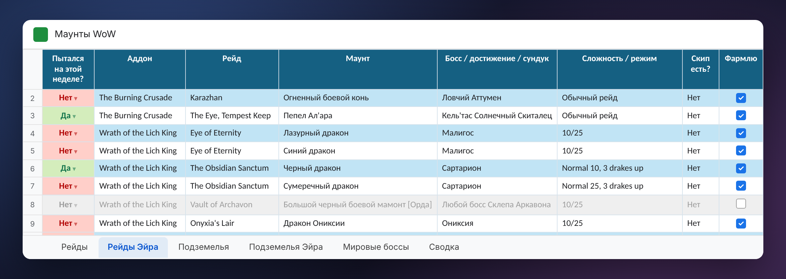

# Google-таблица

Создаёт её программа (`SheetBuilder.Requests` одним `batchUpdate`, `SheetCreator`). Данные строк — из каталога
`program/catalog.json` (версия `2026-11-10`: Рейды 91, Подземелья 67, Мировые боссы 6, Редкие монстры 64 строки; колонки
каталога, включая `ID в игре`, `ID босса` = dungeonEncounterID, `ID в журнале`, `ID места`, `ID статистики` —
статистики убийств игры через «/»). Каталог собирается скриптами `tools/catalog/` и `tools/i18n/`; колонки
`ID …` кроме `ID в игре` в таблицу не попадают (`INTERNAL` в `build_sheet.py`).

## Листы и колонки (имена — внутренние русские, см. «Языки»)

**Рейды**: `Собрано?`, Аддон, Рейд, Маунт, Тип источника, Босс / достижение / сундук, Сложность / режим,
Сброс / частота, `Осталось попыток выбить` (формула), Скип есть?, Как работает скип, Совет по фарму, Статус,
Источник, Шанс выпадения, **`Попыток`**, **`Шанс за все попытки`**, `ID в игре` (скрыта).

**Подземелья**: `Собрано?`, Аддон, Подземелье / активность, Маунт, Тип источника, Босс / достижение / условие,
Сложность / режим, Сброс / частота, Скип / маршрут, Шанс выпадения, **`Попыток`**, **`Шанс за все попытки`**,
Совет по фарму, Статус, Источник, `ID в игре` (скрыта).

**Редкие монстры** (с 2.9.2, layout 5; все рары каталога — layout 6): `Собрано?`, Аддон, Локация, Маунт, Босс / достижение / сундук, Сброс / частота,
Последнее убийство (текст «дд.мм чч:мм Имя»), Совет по фарму, Шанс выпадения, Попыток, Шанс за все попытки, Источник, `ID в игре`
(скрыта). Колонок персонажей нет: откат считает аддон. «Сброс недели» лист не трогает. Старые таблицы: `SheetUpgrade.MoveRares`
переносит строки рар каталога с «Мировых боссов» вместе с «Собрано?» и «Попыток»; строк нет — лист создаёт layout 6.
`SheetUpgrade.AddRares` (layout 6, 2.10.1): рары каталога, которых нет на листе (по `ID в игре`, иначе по маунту), дописываются
в конец (`SheetBuilder.AppendRare`: строки сетки, значения, шрифт, своя полоса, список «Да»/«Нет», формулы шанса со своими
номерами строк); листа нет, а «Мировые боссы» есть — лист создаётся из всего каталога. «Шанс выпадения» — с десятыми (`0.0%`). У листа рар в каталоге есть колонка «ID существ» (на лист не пишется):
номера НИП строки, их программа отдаёт аддону (`npcs`). «Сброс / частота» = «Без отката» — откат 0: маунт с любого из
нескольких раров, у каждого своя дневная добыча (Танаан, «Любой редкий монстр: <зона>» Midnight, завоеватели Зандалари).
Колонка каталога «Точка» (тоже не на листе): `uiMap x y` в процентах, у раров с несколькими местами — только `uiMap`; из неё
`tools/catalog/entrances.py` пишет `ns.RARE_SPOTS` для Ctrl + щелчка в окне аддона.

**Мировые боссы**: `Собрано?`, Аддон, Локация, Маунт, Босс / достижение / сундук, Сброс / частота,
`Осталось попыток выбить`, Совет по фарму, Шанс выпадения (число, формат %), **`Попыток`**,
**`Шанс за все попытки`**, Источник, затем по колонке-галочке на персонажа. Первая колонка персонажа ищется как
«сразу за Источником» (`SheetBuilder.WorldFirstCharColumn`), а не по числу колонок.

**Рейды <Имя>**: `Пытался на этой неделе?`, Аддон, Рейд, Маунт, Босс…, Сложность, Скип есть?, `Фармлю` —
несобранные «Босс-дроп» со статусом «Фармится». **Подземелья <Имя>**: то же для подземелий (все несобранные,
кроме недоступных), вместо скипа — «Скип / маршрут». **Сводка**: всего / собрано / осталось / недоступно по листам.

Оформление: «Да» зелёное, «Нет» красное (условное форматирование), выпадающие списки «Собрано?» и «Статус»,
полосы, фильтр на общих листах прячет собранные и недоступные, на листах персонажей снятая «Фармлю» — серым.

## Формулы

- `Осталось попыток выбить` на Рейдах: `MAP(D2:D, LAMBDA(m, SUM(COUNTIFS('Рейды X'!D:D, m, 'Рейды X'!A:A, "Нет", 'Рейды X'!H:H, TRUE) …)))`
  — у скольких персонажей маунт ещё «Нет» (только с «Фармлю»). На Мировых боссах — сколько галочек не стоит.
- `Шанс за все попытки` в каждой строке: `=IF(N(P2)>0, 1-(1-1/100)^P2, "")` — шанс дробью из целых чисел,
  чтобы формула не зависела от десятичного знака локали. Формат `0.0%`.
- Формулы пишутся с запятыми (как en_US); для локалей с десятичной запятой «,» → «;» (`LocalizeFormulas`).
  Таблица создаётся в en_US, локаль языка ставится последним запросом.

## Что меняет программа

Только «Пытался на этой неделе?», «Собрано?», «Фармлю», «Попыток», галочки персонажей на Мировых боссах;
удаляет строки собранных маунтов с листов персонажей; листы персонажей добавляет/удаляет по «Персонажи в
таблице…». Ячейки с чужими формулами не трогает.

**Раздельные сохранения** (с 2.9.2): строка рейда со сложностью `Normal/Heroic/Mythic` (`SeparateRow`) — три попытки в неделю.
Убийство на сложности 14, 15 или 16 пишет букву в скрытую колонку `N/H/M` листа «Рейды <Имя>» («N,M»; колонка появляется при первом
таком убийстве); «Да» в «Пытался…» — только когда убиты все три. Ручная отметка сразу ставит «Да», «Сброс недели» чистит колонку.
Строки `Normal/Heroic` старых рейдов остаются как есть: там сохранение общее. `script/Code.gs` этого не умеет: он только для старых таблиц.

Логика отметок — `SheetLogic` (порт `doPost` из `script/Code.gs`): `ProcessKill` ищет строки по имени босса
(+ имена по `encounterID` из каталога и Атласа, `Encounters`), сложности (`DifficultyMatches`, ID сложностей
игры), строкам «Любой босс …»; «Сброс недели» ставит «Нет» везде; `MarkCollected`, `SetFarm`; `Status` —
список «Осталось» для аддона (+ `mounts` для счётчика попыток).

## Счётчик попыток (2.8, `SheetAttempts.cs`)

- Строка со случайным шансом (`DropChance`: «1%», «~1%», «<1%», число 0.01; не «100%», «Достижение»,
  «Гарантированно», «Покупка») получает `Попыток` = 0 и формулу шанса; остальные — пусто, их не считают.
- Убийство (не `again`) → +1 у несобранных строк общего листа этого вида (raid → Рейды, party/scenario →
  Подземелья, world → Мировые боссы; ручная отметка — только Мировые боссы) с подходящей сложностью.
  Считаются и устаревшие (до сброса недели) убийства. Своё число в ячейке — продолжается с него.
- В ответе на убийство — `attempts: [{mount, n, p, sheet, row}]` (в журнал программы: «[#] … попытка N, шанс…»).
- В `status` — `mounts`: несобранные строки со счётчиком (`kind`, `boss`, `names`, `d`, `n`, `p`, `id`).
- Известное ограничение: если связь оборвалась после записи, но до ответа, попытка может посчитаться дважды.
- **Попытки до аддона (2.9, `CollectionSync.ImportAttempts`)**: у строки каталога `ID статистики` — статистики
  убийств игры только нужных сложностей (список и источник — `tools/catalog/statistic_ids.py`: 51 маунт, 86
  статистик; данные игры, таблица Achievement с флагом 1). При сверке с коллекцией «Попыток» несобранного маунта
  = max(ячейка, сумма статистик всех персонажей `GameSnapshot.StatTotal`). Только вверх → убийства, уже
  посчитанные программой, дважды не считаются (они есть и в статистике), своё большее число остаётся. Формулы,
  пустые ячейки не трогаем; собранный маунт — только пока там 0 (один раз: видно, сколько попыток ушло; в число
  попадут и убийства после того, как он выпал), дальше его число не меняется; строки находятся по `ID в игре` (на «Мировых боссах» — по
  названию и боссу через `MountIndex`). Без статистики (свой босс не считается игрой или статистика включает
  лишние сложности): Аттумен (Каражан и Возвращение), Анзу, Скади, Альтаирий, Камнедроб, Мандокир/Килнара,
  Ночная Погибель, HK-8 (эпох.), Магистерская терраса BC, Окулус, Тазавеш, трэш AQ, Торгаст, путешествия во
  времени, рары (Кролок, Исхак), «Светящийся споролет». Ограничение: эпохальные+ ключи, возможно, идут в
  статистику эпохального режима — тогда они тоже попытки (обычно так и есть).

## Версии вида таблицы (`SheetUpgrade`, свойство `layout`)

| layout | Что добавляет | Когда |
| --- | --- | --- |
| 0 | таблицы 2.0/2.1 | — |
| 2 | «Да»/«Нет» цветом, «Фармлю» на листах персонажей, новая формула «Осталось попыток» | 2.2 |
| 3 | `Попыток` и `Шанс за все попытки` (insertDimension справа от «Шанса выпадения»; на Мировых боссах — перед персонажами) | 2.8 |
| 4 | формат этих колонок ещё раз — по ячейкам (`AttemptFormatsAgain`): в 2.8 repeatCell пропустил строки, скрытые фильтром (собранные маунты), и шанс там был дробью 0,0394 | 2.9 |
| 5 | лист «Редкие монстры»: рары каталога переезжают с «Мировых боссов» (`MoveRares`) | 2.9.2 |
| 6 | рары каталога, которых нет на листе «Редкие монстры», дописываются в конец; листа нет — создаётся (`AddRares`) | 2.10.1 |

Обновление — один раз при загрузке таблицы (`GoogleBook.Load` → `Ensure`), одним пакетом, свойство в том же
пакете. Новая таблица сразу получает текущий `layout`. Колонку «ID в игре» добавляет `CollectionSync`.

## Сверка с коллекцией (`CollectionSync`)

1) скрытая колонка `ID в игре` (если нет); 2) названия маунтов из каталога → как в игре; 3) «Собрано?» = «Да»
по mountID (без ID — по имени), обратно в «Нет» не ставит; 4) «Попыток» по статистике убийств (2.9, см. выше);
5) убирает собранные с листов персонажей. Идёт сама после каждого входа в игру (новый `collection.updated`).

## Метаданные таблицы

Developer metadata `mountSheetSync` = `{app, catalog, lang}`; свойства с префиксом `mountSheetSync.`: `layout`,
`collectionChecked` (снимок коллекции, с которым сверено), `lastWeekReset`.

## Языки (`SheetLang.cs`)

Внутри программы таблица всегда «русская»: при чтении названия листов, заголовки и слова списков переводятся
в русские, при записи — обратно (`Outgoing`, `ValueOut`, `Response`). Переводы: `tools/i18n/sheet_words.txt`
(слова, 5 языков), `sheet_content.txt` (тексты каталога → английский), `mounts_en.txt` → `program/sheet-i18n.json`
(`build_sheet.py --check` ловит русские строки SheetBuilder.cs без перевода — шаблоны поиска колонок держим в
SheetLogic). Маунты/боссы/подземелья на языке таблицы — из игры, если она на этом языке, иначе английские.
